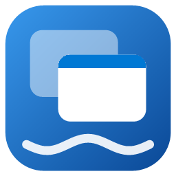
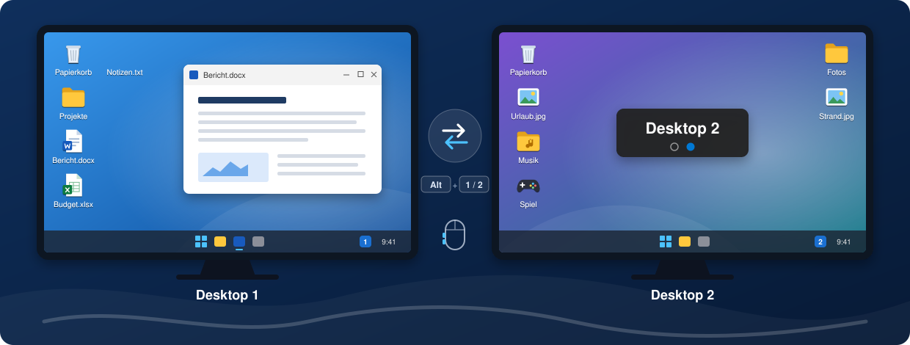
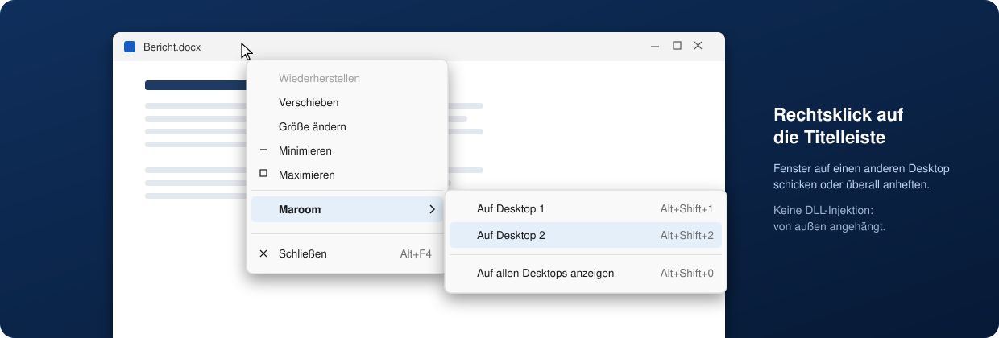
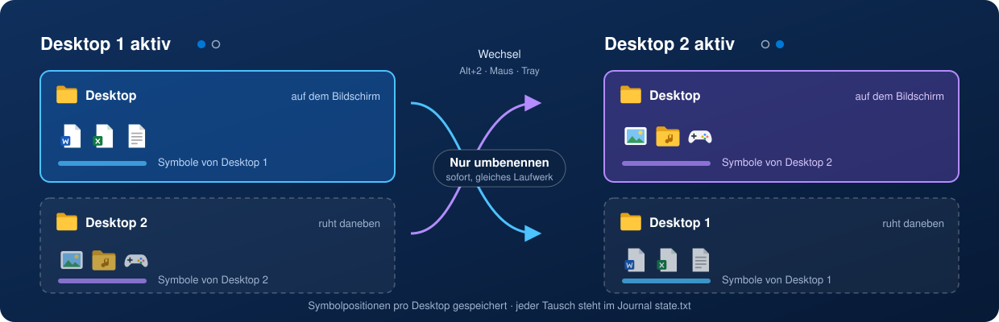

#  Maroom

**Eigene Räume auf den virtuellen Desktops von Windows 11.**

[English version](README.md) · [Lizenz: MIT](LICENSE) · [](https://github.com/TiDo12345/maroom/actions/workflows/build.yml)



Maroom gibt jedem virtuellen Desktop von Windows 11 **eigene Desktop-Symbole an eigenen Positionen**. Das können die eingebauten virtuellen Desktops nicht. Dazu kommt, was früher Werkzeuge wie Dexpot boten: Wechsel mit den Maus-Seitentasten, Tastenkürzel und das Verschieben von Fenstern über das Fenstermenü.

- Eigene Desktop-Symbole und eigene Anordnung pro virtuellem Desktop
- Wechsel mit den Seitentasten Zurück/Vor (über dem Desktop oder wenn er aktiv ist), Alt+1 / Alt+2 oder über das Tray-Symbol
- Aktives Fenster auf einen anderen Desktop schicken (Alt+Shift+1/2) oder auf allen Desktops anzeigen (Alt+Shift+0)
- Untermenü „Maroom ▸“ im Fenstermenü jedes Programms (Rechtsklick auf die Titelleiste), ohne DLLs in fremde Programme einzuschleusen
- Kurze Einblendung beim Wechsel, Tastenkürzel pausieren im Vollbild (Spiele, Videos)
- Oberfläche auf Deutsch und Englisch
- Installation pro Benutzer ohne Administratorrechte, Deinstallation über Einstellungen → Apps

> [!NOTE]
> Maroom unterstützt derzeit **zwei** Desktops. Entwickelt und getestet wurde es auf Windows 11 24H2/25H2 (Build 26300). Für das Verschieben und Anheften von Fenstern nutzt Maroom nicht dokumentierte Explorer-Schnittstellen. Ändert Microsoft sie bei einem Update, schaltet Maroom nur diese Funktionen ab.

## Installation

1. `Maroom-Setup.exe` aus dem [neuesten Release](https://github.com/TiDo12345/maroom/releases/latest) herunterladen.
2. Ausführen. Das Setup ist nicht signiert, deshalb zeigt Windows SmartScreen eventuell „Der Computer wurde durch Windows geschützt“. Dann **Weitere Informationen** → **Trotzdem ausführen**. Alternativ kannst du Maroom [selbst bauen](#selbst-bauen).
3. Auswählen, ob Maroom mit Windows starten und einen Startmenü-Eintrag bekommen soll.

Maroom wird nur für den angemeldeten Benutzer nach `%LOCALAPPDATA%\Maroom` installiert. Deinstallieren lässt es sich unter **Einstellungen → Apps → Installierte Apps → Maroom**.

## Bedienung

| Was | Maus | Tastatur | Sonst |
| --- | --- | --- | --- |
| Desktop wechseln | Mauszeiger auf eine freie Stelle des Desktops, dann Zurück/Vor | **Alt+1 / Alt+2**, Win+Strg+Pfeil | Linksklick auf das Tray-Symbol |
| Aktives Fenster verschieben | Rechtsklick auf die Titelleiste → **Maroom ▸ Auf Desktop N** | **Alt+Shift+1 / Alt+Shift+2** | – |
| Fenster auf allen Desktops anzeigen (an/aus) | Rechtsklick auf die Titelleiste → **Maroom ▸ Auf allen Desktops anzeigen** | **Alt+Shift+0** | – |



Das Tray-Symbol zeigt die Nummer des aktiven Desktops. Über sein Menü kannst du außerdem:
- den Desktop-Ordner öffnen und die Symbolpositionen speichern,
- das Protokoll anzeigen,
- Einblendung und Fenstermenü-Eintrag ein- und ausschalten,
- den Start mit Windows einstellen,
- die Sprache wählen (Automatisch, Deutsch, English),
- unter „Info“ Version und Status sehen.

## So funktionieren die eigenen Desktop-Symbole

Windows hat nur einen Desktop-Ordner für alle virtuellen Desktops. Maroom tauscht deshalb beim Wechsel dessen Inhalt aus. Beide Ordner liegen auf demselben Laufwerk, das Tauschen ist also nur ein Umbenennen und sofort erledigt.



| Aktiv | Im Desktop-Ordner | Ruht in |
| --- | --- | --- |
| Desktop 1 | Symbole von Desktop 1 | Ordner `Desktop 2` neben deinem Desktop-Ordner |
| Desktop 2 | Symbole von Desktop 2 | Ordner `Desktop 1` neben deinem Desktop-Ordner |

- Die Ordner `Desktop 1` und `Desktop 2` bitte nicht von Hand ändern. Sie enthalten die Symbole des jeweils anderen Desktops.
- Der Papierkorb und Verknüpfungen aus dem öffentlichen Desktop erscheinen auf beiden Desktops.
- Geöffnete und gesperrte Dateien bleiben liegen und werden beim nächsten Wechsel richtig einsortiert.
- Sortierst du Symbole bewusst (z. B. „Sortieren nach Name“), wähle danach im Tray-Menü **Positionen jetzt speichern**.
- Bei der Deinstallation legt Maroom die Symbole von Desktop 1 zurück in den Desktop-Ordner. Der Ordner `Desktop 2` wird nie gelöscht.

## Sicherheit und Robustheit

- **Journal:** Jeder Tausch wird in `state.txt` mitgeschrieben. Ein unterbrochener Tausch, etwa durch Absturz oder Stromausfall, wird genau dort fortgesetzt.
- **Keine DLL-Injektion:** Den Eintrag im Fenstermenü hängt Maroom von außen an, Klicks erkennt es über WinEvents. Eingeschleuste Hook-DLLs sind der Grund, warum ältere Werkzeuge mit Installern kollidieren, die nur Microsoft-signierte DLLs zulassen.
- **Symbolpositionen** werden pro Desktop mit Sicherungen gespeichert. Eine Anordnung, die nach der Standardanordnung von Explorer aussieht (z. B. nach einem Explorer-Neustart), überschreibt nie die echte. Positionen außerhalb des aktuellen Bildschirms überlässt Maroom Explorer.
- **Absturz-Neustart** (höchstens 3-mal in 10 Minuten) und Vollbild-Erkennung. Scheitert ein Update, stellt das Setup die vorherige Version wieder her.
- Alle Daten bleiben lokal in `%LOCALAPPDATA%\Maroom`. Maroom baut keine Internetverbindung auf.

## Selbst bauen

Voraussetzung ist Windows mit .NET Framework 4.x, das in Windows 10/11 enthalten ist. Du brauchst weder SDK noch Visual Studio. Gebaut wird mit dem C#-Compiler, der in Windows mitkommt (`csc.exe`, C# 5).

```powershell
powershell -ExecutionPolicy Bypass -File .\build.ps1
```

Das kompiliert `Maroom.exe` und `Maroom-Setup.exe` nach `dist\` und installiert das Ergebnis mit `Maroom-Setup.exe /quiet`. Das Symbol erzeugt `icon\IconGenerator.cs`; die fertige `icon\maroom.ico` liegt im Repo. `build.ps1 -NoInstall` baut nur.

GitHub Actions baut jeden Push und Pull Request, lässt CodeQL laufen und veröffentlicht beim Push eines Tags wie `v2.10` ein Release mit `Maroom-Setup.exe` und SHA-256-Prüfsumme. Der Tag muss zur Version in `Maroom.cs` passen.

| Datei | Zweck |
| --- | --- |
| [Maroom.cs](Maroom.cs) | Die Tray-App |
| [Setup.cs](Setup.cs) | Installer und Deinstaller (`/quiet`, `/uninstall`) |
| [Container.cs](Container.cs) | Erkennt einen Start aus einer abgeschotteten App (Terminal in einer Store-App) und startet über den Explorer neu |
| [build.ps1](build.ps1) | Bauen und installieren |
| [.github/workflows/](.github/workflows/) | CI-Build, CodeQL, Release |
| [tests/SmokeTest.ps1](tests/SmokeTest.ps1) | End-to-End-Test der installierten Version |
| [icon/](icon/) | Symbol und sein Generator |

## Testen

`tests\SmokeTest.ps1` prüft die installierte Version vollständig. Die 12 Prüfungen umfassen:
- Wechsel mit unveränderten Positionen und Tastenkürzel,
- Fenster verschieben und anheften, Fenstermenü,
- Vollbild-Pause und gesperrte Dateien,
- Protokoll-Fenster und englische Oberfläche,
- Absturz-Neustart, Setup-Rückbau, Deinstallation und Neuinstallation.

Der Test steuert etwa 3–4 Minuten lang den echten Desktop, in der Zeit also Maus und Tastatur nicht benutzen. Danach stellt er alles wieder her.

```powershell
powershell -ExecutionPolicy Bypass -File .\tests\SmokeTest.ps1
```

## Dateien

| Was | Wo |
| --- | --- |
| Programm, Kopie des Deinstallers | `%LOCALAPPDATA%\Maroom\Maroom.exe`, `Maroom-Setup.exe` |
| Zustand, wartende gesperrte Dateien, Symbolpositionen, Sicherungen | `state.txt`, `pending.txt`, `positions-N.txt`, `backup\` in `%LOCALAPPDATA%\Maroom` |
| Einstellungen, Protokoll | `settings.txt`, `Maroom.log` in `%LOCALAPPDATA%\Maroom` |
| Autostart, Deinstallationseintrag | `HKCU\Software\Microsoft\Windows\CurrentVersion\Run` und `...\Uninstall\Maroom` |

## Name

*Maroom* verbindet *marea* (spanisch/italienisch für Gezeiten, also Kommen und Gehen wie Ebbe und Flut) mit *room*. Es klingt außerdem nach „my room“ und „more room“.

## Lizenz

[MIT](LICENSE) © 2026 Timo Dörsam. Die Deklarationen der Schnittstellen für die virtuellen Desktops basieren auf [MScholtes/VirtualDesktop](https://github.com/MScholtes/VirtualDesktop) (MIT), siehe [THIRD-PARTY-NOTICES.md](THIRD-PARTY-NOTICES.md).
