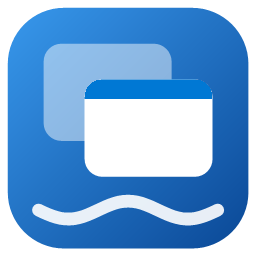
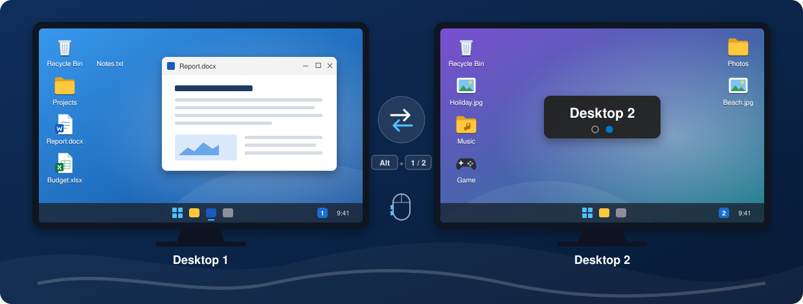
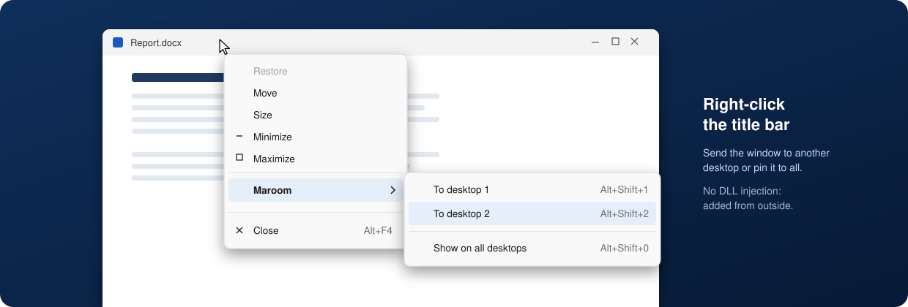
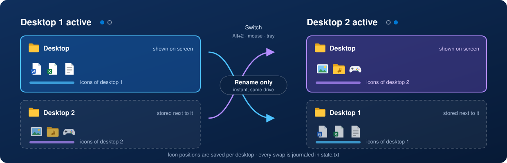

#  Maroom

**Your own rooms on Windows 11 virtual desktops.**

[Deutsche Fassung](README.de.md) · [License: MIT](LICENSE) · [](https://github.com/TiDo12345/maroom/actions/workflows/build.yml)



Maroom gives every Windows 11 virtual desktop **its own desktop icons in their own positions**, something the built-in virtual desktops cannot do. It also adds what tools like Dexpot used to offer: switching with the mouse side buttons, hotkeys, and sending windows to another desktop from the window menu.

- Separate desktop icons and icon layouts per virtual desktop
- Switch with the mouse back/forward buttons (when the desktop is active), Alt+1 / Alt+2 or the tray icon
- Move the active window to another desktop (Alt+Shift+1/2) or show it on all desktops (Alt+Shift+0)
- "Maroom ▸" submenu in every window menu (right-click the title bar), without injecting DLLs into other programs
- Short overlay when switching, hotkeys paused in full screen (games, videos)
- German and English UI
- Per-user install without administrator rights, uninstall from Settings → Apps

> [!NOTE]
> Maroom currently supports **two** desktops. It was developed and tested on Windows 11 24H2/25H2 (build 26300). Moving and pinning windows uses undocumented Explorer interfaces that Microsoft may change in a future update; Maroom then switches only those features off.

## Installation

1. Download `Maroom-Setup.exe` from the [latest release](https://github.com/TiDo12345/maroom/releases/latest).
2. Run it. The setup is not code-signed, so Windows SmartScreen may show "Windows protected your PC" → **More info** → **Run anyway**. If you prefer, [build it yourself](#building-from-source).
3. Choose whether Maroom starts with Windows and gets a Start menu entry.

Maroom installs to `%LOCALAPPDATA%\Maroom` for the current user only. To uninstall, use **Settings → Apps → Installed apps → Maroom**.

## Usage

| What | Mouse | Keyboard | Other |
| --- | --- | --- | --- |
| Switch desktop | Click an empty spot on the desktop, then press back/forward | **Alt+1 / Alt+2**, Win+Ctrl+Arrow | Left-click the tray icon |
| Move the active window | Right-click the title bar → **Maroom ▸ To desktop N** | **Alt+Shift+1 / Alt+Shift+2** | Tray menu |
| Show window on all desktops (toggle) | Right-click the title bar → **Maroom ▸ Show on all desktops** | **Alt+Shift+0** | Tray menu |



The tray icon shows the number of the active desktop. Its menu also lets you open the desktop folder, save icon positions, show the log, turn the overlay and the window menu entry on or off, start with Windows, choose the language (automatic, Deutsch, English), and see version and status (About).

## How the separate desktop icons work

Windows has only one desktop folder for all virtual desktops, so Maroom swaps its contents when you switch. Both folders are on the same drive, so this is only a rename and is instant.



| Active | In the desktop folder | Stored in |
| --- | --- | --- |
| Desktop 1 | icons of desktop 1 | `Desktop 2` folder next to your desktop folder |
| Desktop 2 | icons of desktop 2 | `Desktop 1` folder next to your desktop folder |

- Do not edit the `Desktop 1` / `Desktop 2` folders by hand: they hold the other desktop's icons.
- The Recycle Bin and shortcuts from the public desktop appear on both desktops.
- Files that are open and locked stay where they are and are sorted correctly on the next switch.
- If you deliberately sort your icons (e.g. "Sort by name"), use **Save icon positions now** in the tray menu afterwards.
- On uninstall, Maroom puts the icons of desktop 1 back into the desktop folder. The `Desktop 2` folder is never deleted.

## Safety and robustness

- **Journal:** every swap is recorded in `state.txt`, so an interrupted swap (crash, power loss) resumes exactly where it stopped.
- **No DLL injection:** the window menu entry is added from outside and clicks are detected via WinEvents. (Injected hook DLLs are what makes older tools collide with installers that only allow Microsoft-signed DLLs.)
- **Icon positions** are saved per desktop with backups. A layout that looks like Explorer's default after a reset is never saved over the real one. Positions outside the current screen area are left to Explorer.
- **Crash restart** (at most 3 times in 10 minutes), full screen detection, and a setup that rolls back to the previous version if an update fails.
- All data stays local in `%LOCALAPPDATA%\Maroom`. Maroom does not connect to the internet.

## Building from source

Requirements: Windows with .NET Framework 4.x (included in Windows 10/11). No SDK or Visual Studio is needed; the build uses the C# compiler that ships with Windows (`csc.exe`, C# 5).

```powershell
powershell -ExecutionPolicy Bypass -File .\build.ps1
```

This compiles `Maroom.exe` and `Maroom-Setup.exe` into `dist\` and installs the result with `Maroom-Setup.exe /quiet`. The icon is generated by `icon\IconGenerator.cs`; the generated `icon\maroom.ico` is checked in. `build.ps1 -NoInstall` only builds.

GitHub Actions builds every push and pull request, runs CodeQL, and publishes a release with `Maroom-Setup.exe` and its SHA-256 checksum when a tag like `v2.10` is pushed (the tag must match the version in `Maroom.cs`).

| File | Purpose |
| --- | --- |
| [Maroom.cs](Maroom.cs) | The tray app |
| [Setup.cs](Setup.cs) | Installer and uninstaller (`/quiet`, `/uninstall`) |
| [build.ps1](build.ps1) | Build and install |
| [.github/workflows/](.github/workflows/) | CI build, CodeQL, release |
| [tests/SmokeTest.ps1](tests/SmokeTest.ps1) | End-to-end test of the installed version |
| [icon/](icon/) | Icon and its generator |

## Testing

`tests\SmokeTest.ps1` tests the installed version end to end. It covers 12 checks:

- switching with unchanged icon positions and hotkeys
- moving and pinning windows, and the window menu
- full screen pause and locked files
- log window and English UI
- crash restart, setup rollback, and uninstall/reinstall

It drives the real desktop for about 3–4 minutes (do not use mouse or keyboard meanwhile) and restores everything afterwards.

```powershell
powershell -ExecutionPolicy Bypass -File .\tests\SmokeTest.ps1
```

## Files

| What | Where |
| --- | --- |
| Program, uninstaller copy | `%LOCALAPPDATA%\Maroom\Maroom.exe`, `Maroom-Setup.exe` |
| State, pending locked files, icon positions, backups | `state.txt`, `pending.txt`, `positions-N.txt`, `backup\` in `%LOCALAPPDATA%\Maroom` |
| Settings, log | `settings.txt`, `Maroom.log` in `%LOCALAPPDATA%\Maroom` |
| Autostart, uninstall entry | `HKCU\Software\Microsoft\Windows\CurrentVersion\Run` and `...\Uninstall\Maroom` |

## Name

*Maroom* combines *marea* (Spanish/Italian for tide: ebb and flow, coming and going) and *room*. It also sounds like "my room" and "more room".

## License

[MIT](LICENSE) © 2026 Timo Dörsam. The virtual desktop interface declarations are based on [MScholtes/VirtualDesktop](https://github.com/MScholtes/VirtualDesktop) (MIT), see [THIRD-PARTY-NOTICES.md](THIRD-PARTY-NOTICES.md).
